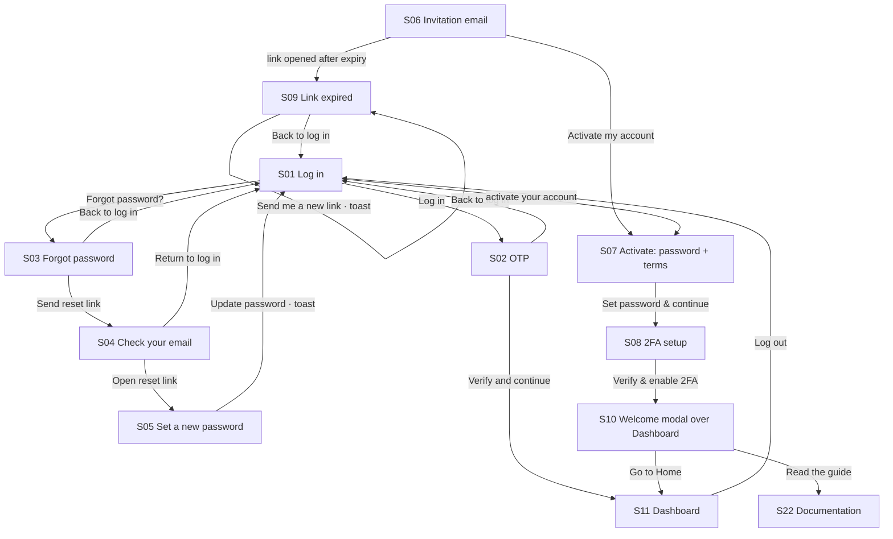
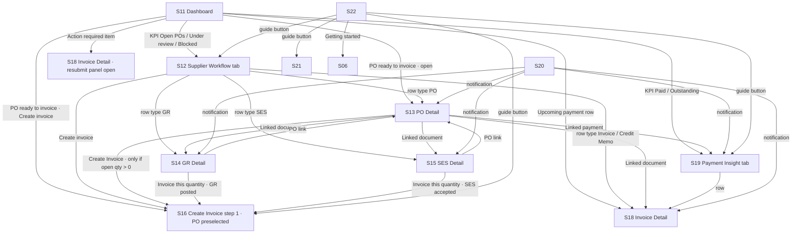
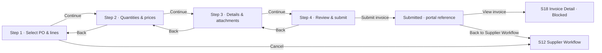
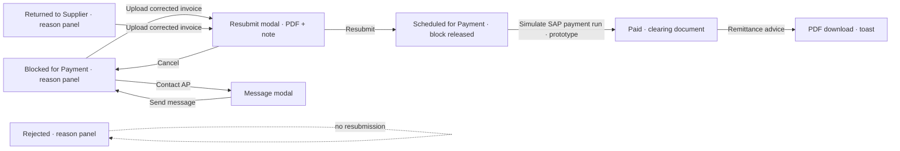
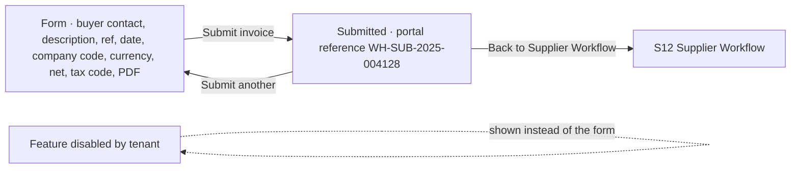
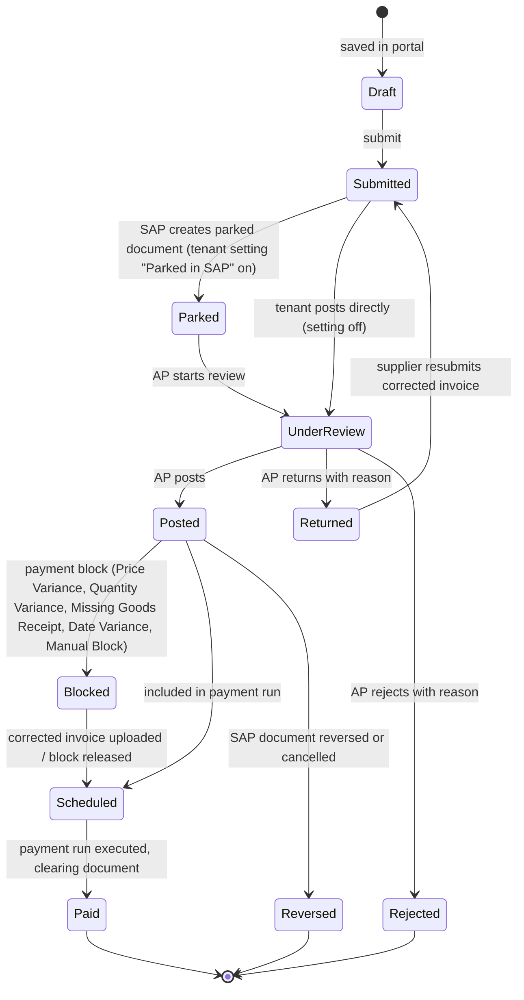
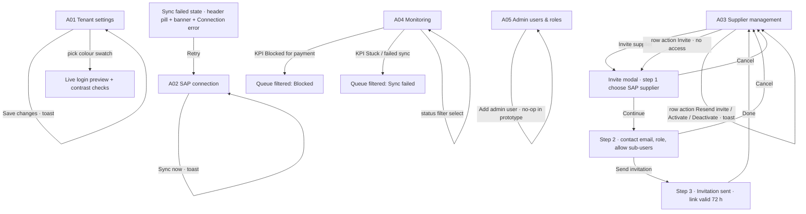
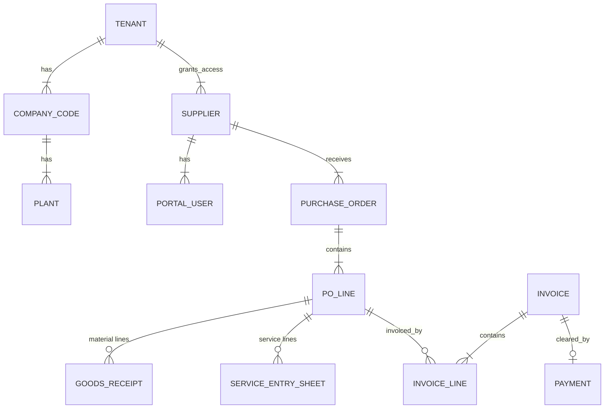
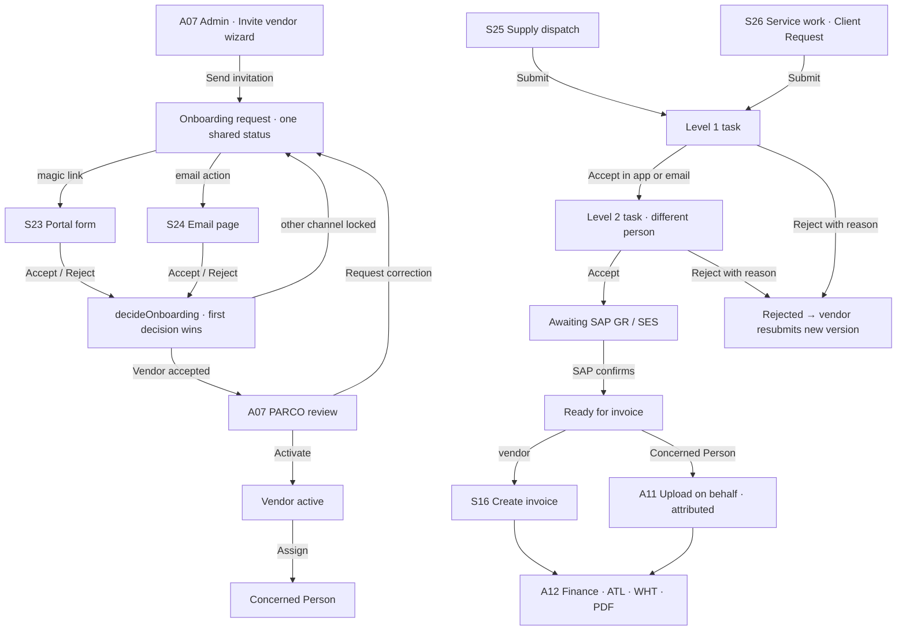

# WaslHub Supplier Invoicing Portal — prototype flow

How the clickable prototype is wired, screen by screen, so it can be drawn as a flow diagram.
Three pages ship in `public/`:

| Page | File | User | Sample identity |
|---|---|---|---|
| Supplier Portal | `index.html` | Vendor user | Lena Marsh (Demo), Vendor Organization Admin of Indus Technical Trading & Services (Demo), V-1000236, at tenant PARCO — Pakistan |
| Tenant Admin | `admin.html` | PARCO staff | Ayesha Khan (PARCO Admin) by default; switch to Finance, Approver 1 / 2 or Concerned Person from the Prototype dock |
| Design System & Change Log | `design-system.html` | Reference only | Status tags, theme tokens, theme demo, change log, acceptance checklist |

Every Mermaid block below renders on GitHub. Section 10 repeats the same edges as a flat table for Figma / FigJam / Miro.

---

## 1. Screen inventory

Use the IDs as node names.

### Supplier Portal

| ID | Screen | Page label in the prototype | Purpose |
|---|---|---|---|
| S01 | Log in | 01 Auth · Log in | Tenant-branded login. No credential check in the prototype. |
| S02 | OTP | 01 Auth · OTP | 6-digit code; any digits pass. |
| S03 | Forgot password | 01 Auth · Forgot password | Enter email. |
| S04 | Check your email | (same screen, sent state) | Reset link sent. Prototype button opens the link. |
| S05 | Set a new password | 01 Auth · Reset password | Password rules checklist. |
| S06 | Invitation email | 01 Onboarding · Invitation email | Email the buyer sends to a new supplier. |
| S07 | Activate account | 01 Onboarding · Set password | Step 1 of 2: set password, accept terms. |
| S08 | Secure your account | 01 Onboarding · 2FA setup | Step 2 of 2: QR code, authenticator code. |
| S09 | Link expired | 01 Auth · Link expired | Invitation / reset link expired or used. |
| S10 | Welcome modal | (over Dashboard) | First-time hints after onboarding. |
| S11 | Home / Dashboard | 02 Dashboard | KPIs, action required, upcoming payments, POs ready to invoice. |
| S12 | Supplier Workflow | 03 Supplier Workflow | All SAP documents: tabs, search, filters, sort, pagination, export. |
| S13 | PO Detail | 04 PO Detail | Header, lines with open-to-invoice qty, linked documents. |
| S14 | GR Detail | 04 GR Detail | Read-only goods receipt (material document). |
| S15 | SES Detail | 04 SES Detail | Read-only service entry sheet. |
| S16 | Create Invoice / Credit Memo | 05 Create Invoice / Credit Memo | 4-step wizard plus success screen. |
| S17 | Standalone Invoice | 05 Standalone Invoice | Non-PO invoice form plus submitted screen. Can be disabled per tenant. |
| S18 | Invoice Detail | 05 Invoice Detail | Timeline, reason panel, lines, totals, attachments, audit trail. |
| S19 | Payment Insight | 06 Payment Insight | Aging buckets, payments list, remittance download. |
| S20 | Notifications | 07 Notifications | In-app list plus email template preview. |
| S21 | Profile | 07 Profile | Read-only supplier data, request change, portal users. |
| S22 | Documentation | 07 Documentation | Nine in-app guides (getting started, invoice, credit memo, standalone, statuses, blocked reasons, payments, users, formats) with a button into the related screen. |
| S23 | Onboarding · magic link form | 01 Onboarding · Magic Link | Public page from the invitation link: SAP-prefilled review, acknowledgement, Accept / Reject. Shares one status with S24. |
| S24 | Onboarding · email action | 01 Onboarding · Email Action | Public verified decision page opened from the (simulated) email. Shares one status with S23. |
| S25 | Supply Workflow | 03 Supply Workflow | Dispatch against SAP POs, evidence, two-person PARCO approval timeline, SAP GR status, resubmission. |
| S26 | Services Workflow | 03 Services Workflow | Enabled services, PARCO client requests, service work submission, approval timeline, SES status. |

### Tenant Admin

| ID | Screen | Purpose |
|---|---|---|
| A01 | Tenant settings | Branding, regional formats, feature toggles, tolerances, attachment rules, live login preview. |
| A02 | SAP connection | Connection status, last sync, errors, sync log, company codes in scope. |
| A03 | Supplier management | SAP suppliers and portal access; invite flow (3-step modal). |
| A04 | Monitoring | KPI cards and exception queue (blocked, returned, sync failed). |
| A05 | Admin users & roles | Roles and admin user list. |
| A06 | Overview | PARCO KPIs, needs-attention list with Due On and Send reminder, recent activity. |
| A07 | Vendor Onboarding | Requests with shared channel status; Invite vendor wizard (5 steps); detail with channel cards, reminders, revoke, review & activate, Concerned Person assignment, SAP-prefilled form, activity. |
| A08 | Vendors | SAP vendor master with profile, ATL check, capability changes, Concerned Person, people, contact & activity log, invoices and submissions, on-behalf upload entry. |
| A09 | Supply Approvals / Service Approvals | Submissions with Level 1 / Level 2 stepper, Accept / Reject in app, email action preview, reminders, SAP confirmation (simulated), client requests (services). |
| A10 | Services Master Data | SAP service catalogue, eligibility, PARCO drafts. |
| A11 | Assigned Vendors | Concerned Person view: assigned vendors, Upload invoice on behalf, notes. |
| A12 | Finance & Invoices / Payment Insight | All vendor invoices with uploader attribution, ATL, WHT, status actions, View / Download PDF. |
| A13 | Notifications & Reminders / Audit & Contact Logs / Email Action | Due items with reminders and history; immutable audit with filters and CSV export; standalone approver decision page. |

---

## 2. Authentication and onboarding

Rules shown on these screens: consent text under the Log in button, tenant branding on the left panel (3 rotating slides), OTP code expiry, reset link valid 30 minutes, invitation link valid 72 hours and single use.

---

## 3. Supplier navigation shell

Available on every signed-in screen (S11–S22).

| Element | Target |
|---|---|
| Sidebar: Home | S11 |
| Sidebar: Supplier Workflow | S12 |
| Sidebar: Payment Insight | S19 |
| Sidebar: Notifications (unread badge) | S20 |
| Sidebar: Profile | S21 |
| Sidebar: Documentation | S22 |
| Sidebar: Log out | S01 |
| New document → Invoice against PO | S16 (document type Invoice) |
| New document → Credit memo | S16 (document type Credit Memo) |
| New document → Standalone invoice | S17 |
| Header: Last synced with SAP pill, sync icon | Toast "Sync requested"; in the failed state a Retry button restores sync |
| Header: company selector (All companies / 1000 / 2000) | Filters every list and total to the selected company code |
| Header: bell | S20 |
| Header: user | S21 |
| Breadcrumb "Supplier Workflow" on detail screens | S12 |

---

## 4. Document flows (supplier)

### 4a. Create Invoice / Credit Memo wizard (S16)

Step rules:

- Step 1: document type toggle (Invoice / Credit Memo, credit memo switchable per tenant); PO cards show open-to-invoice value and are disabled when nothing is open; only lines with open received (GR) or accepted (SES) quantity can be selected.
- Step 2: per line ordered, received, already invoiced, open qty, PO unit price; entering a quantity above the open qty or a price outside the tenant tolerance (±2.00 %) shows an inline warning "may cause the invoice to be blocked for payment". Submission is still allowed.
- Step 3: supplier invoice ref. (mandatory, unique check), invoice date typed in tenant format, tax code from SAP for the company code, payment terms read-only, invoice PDF mandatory (max 10 MB), up to 5 supporting files.
- Step 4: summary, warnings count, confirmation checkbox.
- Save as draft is available at every step (toast).
- After submit the new invoice appears everywhere as NIS-INV-2025-0871, posted as 5105600123 / 2025 and blocked (Price Variance when the price was changed, otherwise Quantity Variance or Manual Block).

### 4b. Invoice Detail exception loop (S18)

### 4c. Standalone (non-PO) invoice (S17)

### 4d. Profile (S21)

Request change → modal (field, new value, supporting document) → Send request → confirmation "Change request CR-2025-0193 sent". Invite user → toast. All supplier master data is read-only from SAP; bank account shows the last 4 digits only.

---

## 5. Status models

### Invoice lifecycle

### Other documents

| Object | States |
|---|---|
| Purchase Order | Open → Partially Delivered → Fully Delivered → Partially Invoiced → Fully Invoiced → Closed |
| Goods Receipt (material document) | Posted ↔ Reversed |
| Service Entry Sheet | Pending Acceptance → Accepted or Rejected |

Workflow tabs map onto these states: All · Action Required (returned, blocked, draft) · In Process (submitted, parked, under review, SES pending) · Posted (posted, scheduled, GR posted, SES accepted) · Paid · Rejected (rejected, reversed, GR reversed, SES rejected).

---

## 6. Tenant Admin flows

Sidebar on every admin screen: Tenant settings, SAP connection, Supplier management, Monitoring (badge = exception count), Admin users & roles. Header: last-sync pill (or red "SAP sync failed · Retry"), signed-in admin.

---

## 7. Prototype controls (floating "Prototype" dock)

| Control | Supplier Portal | Tenant Admin |
|---|---|---|
| Flows | Login · Onboarding · Link expired · Reset password · Invoice happy path + blocked · Payments | — |
| Jump to screen | Any of S01–S22 | A01–A05 |
| Table state (all lists) | Data · Loading · Empty · Error for workflow, payments, notifications, PO linked documents | Same for all four admin tables |
| SAP sync | Synced · Sync failed (header pill, banner, table error state) | Synced · Sync failed (pill, banner, connection card, sync-log row) |
| Invoice NIS-INV-2025-0871 | Blocked · Scheduled · Paid | — |

Prototype-only helpers (reset-link opener, expired-link opener, payment-run simulator) are hidden when the dock is switched off via the `showPrototypeDock` property.

Recommended demo path: Log in → Dashboard → PO 4500012345 → Create Invoice (change a unit price) → Submitted → View invoice (Blocked, Price Variance) → Upload corrected invoice → Resubmit (Scheduled) → Simulate payment run (Paid) → Remittance advice. Admin path: Supplier management → Invite supplier → three steps.

---

## 8. Sample data map

| Entity | Sample values |
|---|---|
| Tenant | Demo Buyer Co. (alternate theme: Sample Tenant Group); company codes 1000 and 2000; plants 1100, 1200 |
| Supplier | 1000234 Northline Industrial Supplies LLC; users Lena Marsh (admin), Daniel Okafor, Priya Raman |
| POs | 4500012345 Packaging Materials (USD, material), 4500012388 Equipment Preventive Maintenance (USD, service), 4500012402 Safety Gloves (OMR), 4500012410 Hydraulic Hose Fittings (SAR) |
| Receipts | GR 5000004567 / 2025, 5000004589 / 2025, 5000004571 / 2025 (reversed); SES 1000000456 (accepted), 1000000461 (pending) |
| Invoices | NIS-INV-2025-0871 → SAP 5105600123 / 2025 (happy path); 0856 blocked Date Variance; 0862 returned; 0851 rejected; 0864 and 0849 paid; 0866 scheduled; 0833, 0815 posted; CM NIS-CM-2025-0012 |
| Payments | clearing 1500000789 (27-Oct-2025, bank transfer), 1500000771, 1500000752 |
| Tax codes | Company 1000: V5 VAT 5 %, V0 Zero-rated, VE Exempt; company 2000 adds S1 VAT 15 % |

---

## 9. Design rules visible in every flow

- Dates follow the tenant format (default DD-MMM-YYYY); typed date fields validate against it.
- Amounts are right-aligned with the currency code; 3-decimal currencies (OMR, KWD, BHD) show 3 decimals; mixed-currency lists show totals per currency.
- Net, Tax and Gross are always shown separately.
- SAP keys appear as "Number / Fiscal Year".
- Every SAP screen shows "Last synced with SAP" and has a sync-failed state with Retry.
- Every list has sort indicators, pagination and loading / empty / error states.
- Status tags carry an icon and a hover tooltip with meaning and required action; KPI cards, headers and controls carry explanatory tooltips.

---

## 10. PARCO flows

## 11. Flat edge list (for diagram tools)

| From | Trigger | To |
|---|---|---|
| S01 Log in | Log in | S02 OTP |
| S01 | Forgot password? | S03 Forgot password |
| S01 | activate your account | S07 Activate |
| S02 | Verify and continue | S11 Dashboard |
| S02 | Back to log in | S01 |
| S03 | Send reset link | S04 Check your email |
| S04 | Open reset link | S05 Set a new password |
| S05 | Update password | S01 (toast) |
| S06 Invitation email | Activate my account | S07 |
| S07 | Set password & continue | S08 2FA setup |
| S08 | Verify & enable 2FA | S11 + S10 Welcome modal |
| S10 | Read the guide | S22 Documentation |
| S09 Link expired | Back to log in | S01 |
| Any signed-in screen | Log out | S01 |
| S11 | KPI card | S12 tab or S19 tab |
| S11 | Action required item | S18 (resubmit open) |
| S11 | Upcoming payment row | S18 |
| S11 | PO ready to invoice | S13 or S16 |
| S12 | Row (PO / GR / SES / INV / CM) | S13 / S14 / S15 / S18 |
| S12 | Create invoice | S16 |
| S13 | Create Invoice (open qty > 0) | S16 step 1 |
| S13 | Linked document | S14 / S15 / S18 / S19 |
| S14, S15 | Invoice this quantity | S16 |
| S14, S15 | PO link | S13 |
| S16 step 4 | Submit | S16 success |
| S16 success | View invoice | S18 (Blocked) |
| S16 success | Back to Supplier Workflow | S12 |
| S16 step 1 | Cancel | S12 |
| S18 Blocked / Returned | Upload corrected invoice → Resubmit | S18 Scheduled |
| S18 Scheduled | Simulate SAP payment run | S18 Paid |
| S18 Paid | Remittance advice | PDF download |
| S18 | Contact AP → Send message | toast |
| S18 | PO link | S13 |
| S17 form | Submit invoice | S17 submitted |
| S17 submitted | Submit another / Back | S17 form / S12 |
| S19 | Row | S18 |
| S20 | Notification | S18 / S14 / S15 / S13 / S19 |
| S21 | Request change → Send request | confirmation |
| S22 | Guide → button | S16 / S17 / S12 / S19 / S21 / S06 (invitation email) |
| A03 | Invite supplier | Invite step 1 → 2 → 3 → A03 |
| A03 | Row action | A03 (access state changes) |
| A04 | KPI Blocked / Stuck | A04 queue filtered |
| A02 (sync failed) | Retry | A02 synced |
